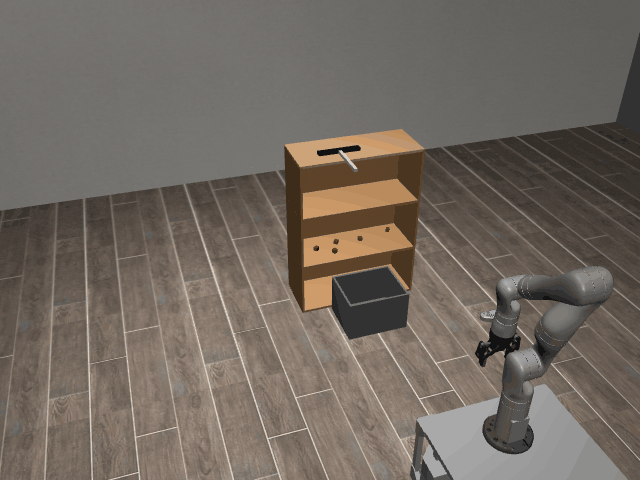
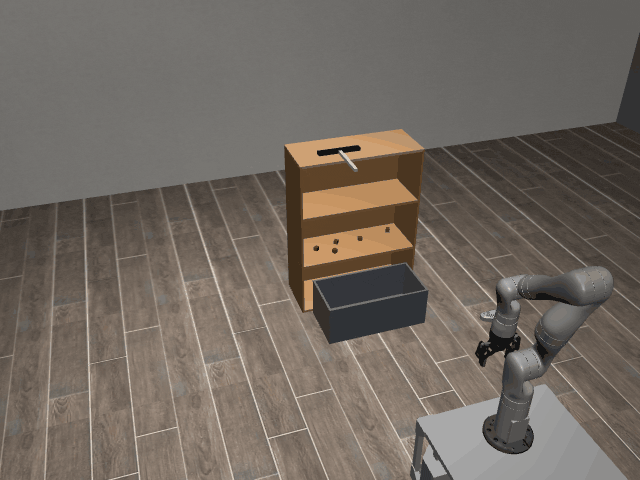

# SweepOffShelf3D

**Random Action Stats**: Total Reward: -25.00, Success: No, Steps: 25

## Description
Sweep cubes off a cupboard shelf, over its open front edge, into a heavy box on the floor below it. The box is far too heavy for the robot to lift.

The robot has a holonomic mobile base with powered casters and a Kinova Gen3 arm.

The robot can control:
- Base pose (x, y, theta)
- Arm position (x, y, z)
- Arm orientation (quaternion)
- Gripper position (open/close)

## Available Variants
Variants differ in the number of cubes on the shelf and in the width of the box.

- [`kinder/SweepOffShelf3D-o5-v0`](variants/SweepOffShelf3D/SweepOffShelf3D-o5.md) (o5)
- [`kinder/SweepOffShelf3D-o5-narrow_box-v0`](variants/SweepOffShelf3D/SweepOffShelf3D-o5-narrow_box.md) (o5-narrow_box)

## Initial State Distribution

## Example Demonstration
*(No demonstration GIFs available)*

## Observation Space
*(Differs per variant, see individual variant pages)*

## Action Space
Actions: base pos and yaw (3), arm joints (7), gripper pos (1)

## Rewards
The primary reward is for successfully placing objects at their target locations.
- A reward of +1.0 is given for each object placed within a 5cm tolerance of its target.
- A smaller positive reward is given for objects within a 10cm tolerance to guide the robot.
- A small negative reward (-0.01) is applied at each timestep to encourage efficiency.
The episode terminates when all objects are placed at their respective targets.

## References
TidyBot++: An Open-Source Holonomic Mobile Manipulator.

               for Robot Learning
               - Jimmy Wu, William Chong, Robert Holmberg, Aaditya Prasad, Yihuai Gao,
                 Oussama Khatib, Shuran Song, Szymon Rusinkiewicz, Jeannette Bohg
               - Conference on Robot Learning (CoRL), 2024

               https://github.com/tidybot2/tidybot2
