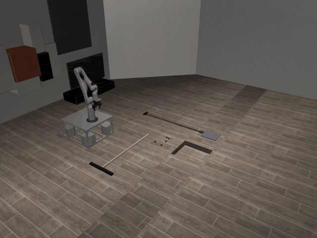
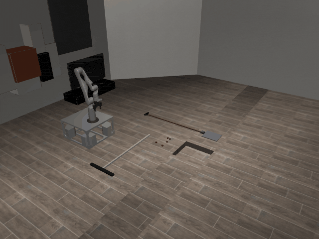

# SweepIntoHole3D-o5

## Usage
```python
import kinder
kinder.register_all_environments()
env = kinder.make("kinder/SweepIntoHole3D-o5-v0")
```

## Description
Five cubes.

## Initial State Distribution


## Random Action Behavior


**Random Action Stats**: Total Reward: -25.00, Success: No, Steps: 25

## Example Demonstration
*(No demonstration GIFs available)*

## Observation Space
The entries of an array in this Box space correspond to the following object features:
| **Index** | **Object** | **Feature** |
| --- | --- | --- |
| 0 | cube_0 | x |
| 1 | cube_0 | y |
| 2 | cube_0 | z |
| 3 | cube_0 | qw |
| 4 | cube_0 | qx |
| 5 | cube_0 | qy |
| 6 | cube_0 | qz |
| 7 | cube_0 | vx |
| 8 | cube_0 | vy |
| 9 | cube_0 | vz |
| 10 | cube_0 | wx |
| 11 | cube_0 | wy |
| 12 | cube_0 | wz |
| 13 | cube_0 | bb_x |
| 14 | cube_0 | bb_y |
| 15 | cube_0 | bb_z |
| 16 | cube_1 | x |
| 17 | cube_1 | y |
| 18 | cube_1 | z |
| 19 | cube_1 | qw |
| 20 | cube_1 | qx |
| 21 | cube_1 | qy |
| 22 | cube_1 | qz |
| 23 | cube_1 | vx |
| 24 | cube_1 | vy |
| 25 | cube_1 | vz |
| 26 | cube_1 | wx |
| 27 | cube_1 | wy |
| 28 | cube_1 | wz |
| 29 | cube_1 | bb_x |
| 30 | cube_1 | bb_y |
| 31 | cube_1 | bb_z |
| 32 | cube_2 | x |
| 33 | cube_2 | y |
| 34 | cube_2 | z |
| 35 | cube_2 | qw |
| 36 | cube_2 | qx |
| 37 | cube_2 | qy |
| 38 | cube_2 | qz |
| 39 | cube_2 | vx |
| 40 | cube_2 | vy |
| 41 | cube_2 | vz |
| 42 | cube_2 | wx |
| 43 | cube_2 | wy |
| 44 | cube_2 | wz |
| 45 | cube_2 | bb_x |
| 46 | cube_2 | bb_y |
| 47 | cube_2 | bb_z |
| 48 | cube_3 | x |
| 49 | cube_3 | y |
| 50 | cube_3 | z |
| 51 | cube_3 | qw |
| 52 | cube_3 | qx |
| 53 | cube_3 | qy |
| 54 | cube_3 | qz |
| 55 | cube_3 | vx |
| 56 | cube_3 | vy |
| 57 | cube_3 | vz |
| 58 | cube_3 | wx |
| 59 | cube_3 | wy |
| 60 | cube_3 | wz |
| 61 | cube_3 | bb_x |
| 62 | cube_3 | bb_y |
| 63 | cube_3 | bb_z |
| 64 | cube_4 | x |
| 65 | cube_4 | y |
| 66 | cube_4 | z |
| 67 | cube_4 | qw |
| 68 | cube_4 | qx |
| 69 | cube_4 | qy |
| 70 | cube_4 | qz |
| 71 | cube_4 | vx |
| 72 | cube_4 | vy |
| 73 | cube_4 | vz |
| 74 | cube_4 | wx |
| 75 | cube_4 | wy |
| 76 | cube_4 | wz |
| 77 | cube_4 | bb_x |
| 78 | cube_4 | bb_y |
| 79 | cube_4 | bb_z |
| 80 | robot | pos_base_x |
| 81 | robot | pos_base_y |
| 82 | robot | pos_base_rot |
| 83 | robot | pos_arm_joint1 |
| 84 | robot | pos_arm_joint2 |
| 85 | robot | pos_arm_joint3 |
| 86 | robot | pos_arm_joint4 |
| 87 | robot | pos_arm_joint5 |
| 88 | robot | pos_arm_joint6 |
| 89 | robot | pos_arm_joint7 |
| 90 | robot | pos_gripper |
| 91 | robot | vel_base_x |
| 92 | robot | vel_base_y |
| 93 | robot | vel_base_rot |
| 94 | robot | vel_arm_joint1 |
| 95 | robot | vel_arm_joint2 |
| 96 | robot | vel_arm_joint3 |
| 97 | robot | vel_arm_joint4 |
| 98 | robot | vel_arm_joint5 |
| 99 | robot | vel_arm_joint6 |
| 100 | robot | vel_arm_joint7 |
| 101 | robot | vel_gripper |
| 102 | shovel_0 | x |
| 103 | shovel_0 | y |
| 104 | shovel_0 | z |
| 105 | shovel_0 | qw |
| 106 | shovel_0 | qx |
| 107 | shovel_0 | qy |
| 108 | shovel_0 | qz |
| 109 | shovel_0 | vx |
| 110 | shovel_0 | vy |
| 111 | shovel_0 | vz |
| 112 | shovel_0 | wx |
| 113 | shovel_0 | wy |
| 114 | shovel_0 | wz |
| 115 | shovel_0 | bb_x |
| 116 | shovel_0 | bb_y |
| 117 | shovel_0 | bb_z |
| 118 | wiper_0 | x |
| 119 | wiper_0 | y |
| 120 | wiper_0 | z |
| 121 | wiper_0 | qw |
| 122 | wiper_0 | qx |
| 123 | wiper_0 | qy |
| 124 | wiper_0 | qz |
| 125 | wiper_0 | vx |
| 126 | wiper_0 | vy |
| 127 | wiper_0 | vz |
| 128 | wiper_0 | wx |
| 129 | wiper_0 | wy |
| 130 | wiper_0 | wz |
| 131 | wiper_0 | bb_x |
| 132 | wiper_0 | bb_y |
| 133 | wiper_0 | bb_z |
