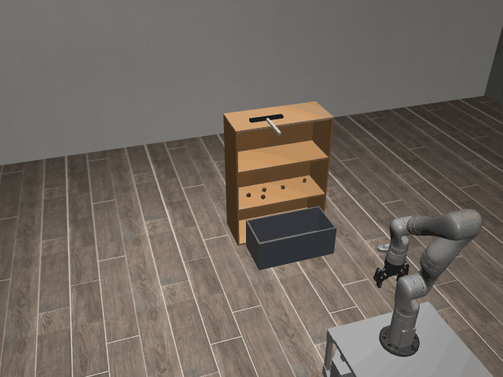

# SweepOffShelf3D-o5

## Usage
```python
import kinder
kinder.register_all_environments()
env = kinder.make("kinder/SweepOffShelf3D-o5-v0")
```

## Description
Five cubes.

## Initial State Distribution


## Random Action Behavior


**Random Action Stats**: Total Reward: -25.00, Success: No, Steps: 25

## Example Demonstration
*(No demonstration GIFs available)*

## Observation Space
The entries of an array in this Box space correspond to the following object features:
| **Index** | **Object** | **Feature** |
| --- | --- | --- |
| 0 | box_0 | x |
| 1 | box_0 | y |
| 2 | box_0 | z |
| 3 | box_0 | qw |
| 4 | box_0 | qx |
| 5 | box_0 | qy |
| 6 | box_0 | qz |
| 7 | box_0 | vx |
| 8 | box_0 | vy |
| 9 | box_0 | vz |
| 10 | box_0 | wx |
| 11 | box_0 | wy |
| 12 | box_0 | wz |
| 13 | box_0 | bb_x |
| 14 | box_0 | bb_y |
| 15 | box_0 | bb_z |
| 16 | collider:cupboard_1:10 | x |
| 17 | collider:cupboard_1:10 | y |
| 18 | collider:cupboard_1:10 | z |
| 19 | collider:cupboard_1:10 | qw |
| 20 | collider:cupboard_1:10 | qx |
| 21 | collider:cupboard_1:10 | qy |
| 22 | collider:cupboard_1:10 | qz |
| 23 | collider:cupboard_1:10 | bb_x |
| 24 | collider:cupboard_1:10 | bb_y |
| 25 | collider:cupboard_1:10 | bb_z |
| 26 | collider:cupboard_1:11 | x |
| 27 | collider:cupboard_1:11 | y |
| 28 | collider:cupboard_1:11 | z |
| 29 | collider:cupboard_1:11 | qw |
| 30 | collider:cupboard_1:11 | qx |
| 31 | collider:cupboard_1:11 | qy |
| 32 | collider:cupboard_1:11 | qz |
| 33 | collider:cupboard_1:11 | bb_x |
| 34 | collider:cupboard_1:11 | bb_y |
| 35 | collider:cupboard_1:11 | bb_z |
| 36 | collider:cupboard_1:12 | x |
| 37 | collider:cupboard_1:12 | y |
| 38 | collider:cupboard_1:12 | z |
| 39 | collider:cupboard_1:12 | qw |
| 40 | collider:cupboard_1:12 | qx |
| 41 | collider:cupboard_1:12 | qy |
| 42 | collider:cupboard_1:12 | qz |
| 43 | collider:cupboard_1:12 | bb_x |
| 44 | collider:cupboard_1:12 | bb_y |
| 45 | collider:cupboard_1:12 | bb_z |
| 46 | collider:cupboard_1:13 | x |
| 47 | collider:cupboard_1:13 | y |
| 48 | collider:cupboard_1:13 | z |
| 49 | collider:cupboard_1:13 | qw |
| 50 | collider:cupboard_1:13 | qx |
| 51 | collider:cupboard_1:13 | qy |
| 52 | collider:cupboard_1:13 | qz |
| 53 | collider:cupboard_1:13 | bb_x |
| 54 | collider:cupboard_1:13 | bb_y |
| 55 | collider:cupboard_1:13 | bb_z |
| 56 | collider:cupboard_1:14 | x |
| 57 | collider:cupboard_1:14 | y |
| 58 | collider:cupboard_1:14 | z |
| 59 | collider:cupboard_1:14 | qw |
| 60 | collider:cupboard_1:14 | qx |
| 61 | collider:cupboard_1:14 | qy |
| 62 | collider:cupboard_1:14 | qz |
| 63 | collider:cupboard_1:14 | bb_x |
| 64 | collider:cupboard_1:14 | bb_y |
| 65 | collider:cupboard_1:14 | bb_z |
| 66 | collider:cupboard_1:15 | x |
| 67 | collider:cupboard_1:15 | y |
| 68 | collider:cupboard_1:15 | z |
| 69 | collider:cupboard_1:15 | qw |
| 70 | collider:cupboard_1:15 | qx |
| 71 | collider:cupboard_1:15 | qy |
| 72 | collider:cupboard_1:15 | qz |
| 73 | collider:cupboard_1:15 | bb_x |
| 74 | collider:cupboard_1:15 | bb_y |
| 75 | collider:cupboard_1:15 | bb_z |
| 76 | collider:cupboard_1:9 | x |
| 77 | collider:cupboard_1:9 | y |
| 78 | collider:cupboard_1:9 | z |
| 79 | collider:cupboard_1:9 | qw |
| 80 | collider:cupboard_1:9 | qx |
| 81 | collider:cupboard_1:9 | qy |
| 82 | collider:cupboard_1:9 | qz |
| 83 | collider:cupboard_1:9 | bb_x |
| 84 | collider:cupboard_1:9 | bb_y |
| 85 | collider:cupboard_1:9 | bb_z |
| 86 | cube_0 | x |
| 87 | cube_0 | y |
| 88 | cube_0 | z |
| 89 | cube_0 | qw |
| 90 | cube_0 | qx |
| 91 | cube_0 | qy |
| 92 | cube_0 | qz |
| 93 | cube_0 | vx |
| 94 | cube_0 | vy |
| 95 | cube_0 | vz |
| 96 | cube_0 | wx |
| 97 | cube_0 | wy |
| 98 | cube_0 | wz |
| 99 | cube_0 | bb_x |
| 100 | cube_0 | bb_y |
| 101 | cube_0 | bb_z |
| 102 | cube_1 | x |
| 103 | cube_1 | y |
| 104 | cube_1 | z |
| 105 | cube_1 | qw |
| 106 | cube_1 | qx |
| 107 | cube_1 | qy |
| 108 | cube_1 | qz |
| 109 | cube_1 | vx |
| 110 | cube_1 | vy |
| 111 | cube_1 | vz |
| 112 | cube_1 | wx |
| 113 | cube_1 | wy |
| 114 | cube_1 | wz |
| 115 | cube_1 | bb_x |
| 116 | cube_1 | bb_y |
| 117 | cube_1 | bb_z |
| 118 | cube_2 | x |
| 119 | cube_2 | y |
| 120 | cube_2 | z |
| 121 | cube_2 | qw |
| 122 | cube_2 | qx |
| 123 | cube_2 | qy |
| 124 | cube_2 | qz |
| 125 | cube_2 | vx |
| 126 | cube_2 | vy |
| 127 | cube_2 | vz |
| 128 | cube_2 | wx |
| 129 | cube_2 | wy |
| 130 | cube_2 | wz |
| 131 | cube_2 | bb_x |
| 132 | cube_2 | bb_y |
| 133 | cube_2 | bb_z |
| 134 | cube_3 | x |
| 135 | cube_3 | y |
| 136 | cube_3 | z |
| 137 | cube_3 | qw |
| 138 | cube_3 | qx |
| 139 | cube_3 | qy |
| 140 | cube_3 | qz |
| 141 | cube_3 | vx |
| 142 | cube_3 | vy |
| 143 | cube_3 | vz |
| 144 | cube_3 | wx |
| 145 | cube_3 | wy |
| 146 | cube_3 | wz |
| 147 | cube_3 | bb_x |
| 148 | cube_3 | bb_y |
| 149 | cube_3 | bb_z |
| 150 | cube_4 | x |
| 151 | cube_4 | y |
| 152 | cube_4 | z |
| 153 | cube_4 | qw |
| 154 | cube_4 | qx |
| 155 | cube_4 | qy |
| 156 | cube_4 | qz |
| 157 | cube_4 | vx |
| 158 | cube_4 | vy |
| 159 | cube_4 | vz |
| 160 | cube_4 | wx |
| 161 | cube_4 | wy |
| 162 | cube_4 | wz |
| 163 | cube_4 | bb_x |
| 164 | cube_4 | bb_y |
| 165 | cube_4 | bb_z |
| 166 | cupboard_1 | x |
| 167 | cupboard_1 | y |
| 168 | cupboard_1 | z |
| 169 | cupboard_1 | qw |
| 170 | cupboard_1 | qx |
| 171 | cupboard_1 | qy |
| 172 | cupboard_1 | qz |
| 173 | robot | pos_base_x |
| 174 | robot | pos_base_y |
| 175 | robot | pos_base_rot |
| 176 | robot | pos_arm_joint1 |
| 177 | robot | pos_arm_joint2 |
| 178 | robot | pos_arm_joint3 |
| 179 | robot | pos_arm_joint4 |
| 180 | robot | pos_arm_joint5 |
| 181 | robot | pos_arm_joint6 |
| 182 | robot | pos_arm_joint7 |
| 183 | robot | pos_gripper |
| 184 | robot | vel_base_x |
| 185 | robot | vel_base_y |
| 186 | robot | vel_base_rot |
| 187 | robot | vel_arm_joint1 |
| 188 | robot | vel_arm_joint2 |
| 189 | robot | vel_arm_joint3 |
| 190 | robot | vel_arm_joint4 |
| 191 | robot | vel_arm_joint5 |
| 192 | robot | vel_arm_joint6 |
| 193 | robot | vel_arm_joint7 |
| 194 | robot | vel_gripper |
| 195 | wiper_0 | x |
| 196 | wiper_0 | y |
| 197 | wiper_0 | z |
| 198 | wiper_0 | qw |
| 199 | wiper_0 | qx |
| 200 | wiper_0 | qy |
| 201 | wiper_0 | qz |
| 202 | wiper_0 | vx |
| 203 | wiper_0 | vy |
| 204 | wiper_0 | vz |
| 205 | wiper_0 | wx |
| 206 | wiper_0 | wy |
| 207 | wiper_0 | wz |
| 208 | wiper_0 | bb_x |
| 209 | wiper_0 | bb_y |
| 210 | wiper_0 | bb_z |
