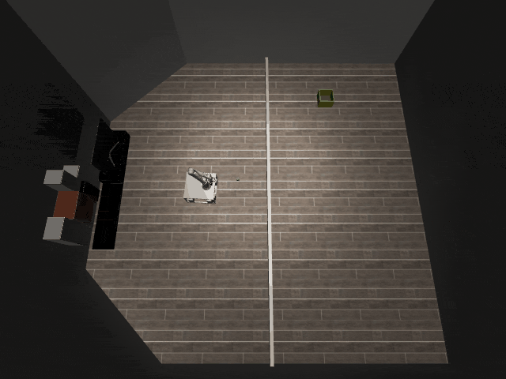
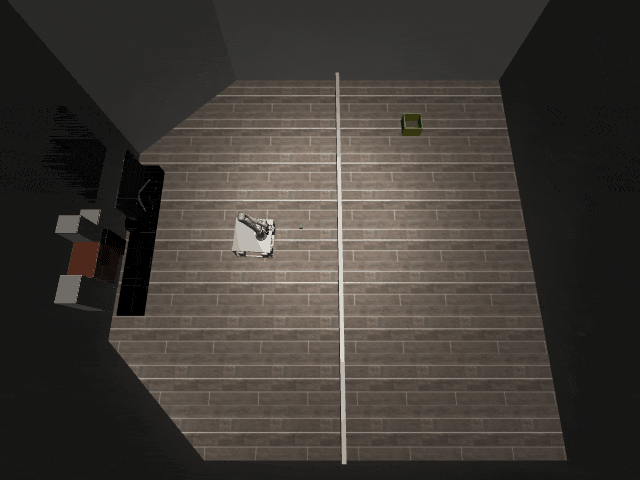

# Tossing3D-o1

## Usage
```python
import kinder
kinder.register_all_environments()
env = kinder.make("kinder/Tossing3D-o1-v0")
```

## Description
Get one cube into the bin.

## Initial State Distribution


## Random Action Behavior


**Random Action Stats**: Total Reward: -25.00, Success: No, Steps: 25

## Example Demonstration
*(No demonstration GIFs available)*

## Observation Space
The entries of an array in this Box space correspond to the following object features:
| **Index** | **Object** | **Feature** |
| --- | --- | --- |
| 0 | bin_0 | x |
| 1 | bin_0 | y |
| 2 | bin_0 | z |
| 3 | bin_0 | qw |
| 4 | bin_0 | qx |
| 5 | bin_0 | qy |
| 6 | bin_0 | qz |
| 7 | bin_0 | vx |
| 8 | bin_0 | vy |
| 9 | bin_0 | vz |
| 10 | bin_0 | wx |
| 11 | bin_0 | wy |
| 12 | bin_0 | wz |
| 13 | bin_0 | bb_x |
| 14 | bin_0 | bb_y |
| 15 | bin_0 | bb_z |
| 16 | collider:cuboid_barrier:9 | x |
| 17 | collider:cuboid_barrier:9 | y |
| 18 | collider:cuboid_barrier:9 | z |
| 19 | collider:cuboid_barrier:9 | qw |
| 20 | collider:cuboid_barrier:9 | qx |
| 21 | collider:cuboid_barrier:9 | qy |
| 22 | collider:cuboid_barrier:9 | qz |
| 23 | collider:cuboid_barrier:9 | bb_x |
| 24 | collider:cuboid_barrier:9 | bb_y |
| 25 | collider:cuboid_barrier:9 | bb_z |
| 26 | collider:tossing_room:3 | x |
| 27 | collider:tossing_room:3 | y |
| 28 | collider:tossing_room:3 | z |
| 29 | collider:tossing_room:3 | qw |
| 30 | collider:tossing_room:3 | qx |
| 31 | collider:tossing_room:3 | qy |
| 32 | collider:tossing_room:3 | qz |
| 33 | collider:tossing_room:3 | bb_x |
| 34 | collider:tossing_room:3 | bb_y |
| 35 | collider:tossing_room:3 | bb_z |
| 36 | collider:tossing_room:4 | x |
| 37 | collider:tossing_room:4 | y |
| 38 | collider:tossing_room:4 | z |
| 39 | collider:tossing_room:4 | qw |
| 40 | collider:tossing_room:4 | qx |
| 41 | collider:tossing_room:4 | qy |
| 42 | collider:tossing_room:4 | qz |
| 43 | collider:tossing_room:4 | bb_x |
| 44 | collider:tossing_room:4 | bb_y |
| 45 | collider:tossing_room:4 | bb_z |
| 46 | collider:tossing_room:5 | x |
| 47 | collider:tossing_room:5 | y |
| 48 | collider:tossing_room:5 | z |
| 49 | collider:tossing_room:5 | qw |
| 50 | collider:tossing_room:5 | qx |
| 51 | collider:tossing_room:5 | qy |
| 52 | collider:tossing_room:5 | qz |
| 53 | collider:tossing_room:5 | bb_x |
| 54 | collider:tossing_room:5 | bb_y |
| 55 | collider:tossing_room:5 | bb_z |
| 56 | collider:tossing_room:6 | x |
| 57 | collider:tossing_room:6 | y |
| 58 | collider:tossing_room:6 | z |
| 59 | collider:tossing_room:6 | qw |
| 60 | collider:tossing_room:6 | qx |
| 61 | collider:tossing_room:6 | qy |
| 62 | collider:tossing_room:6 | qz |
| 63 | collider:tossing_room:6 | bb_x |
| 64 | collider:tossing_room:6 | bb_y |
| 65 | collider:tossing_room:6 | bb_z |
| 66 | collider:tossing_room:7 | x |
| 67 | collider:tossing_room:7 | y |
| 68 | collider:tossing_room:7 | z |
| 69 | collider:tossing_room:7 | qw |
| 70 | collider:tossing_room:7 | qx |
| 71 | collider:tossing_room:7 | qy |
| 72 | collider:tossing_room:7 | qz |
| 73 | collider:tossing_room:7 | bb_x |
| 74 | collider:tossing_room:7 | bb_y |
| 75 | collider:tossing_room:7 | bb_z |
| 76 | collider:tossing_room:8 | x |
| 77 | collider:tossing_room:8 | y |
| 78 | collider:tossing_room:8 | z |
| 79 | collider:tossing_room:8 | qw |
| 80 | collider:tossing_room:8 | qx |
| 81 | collider:tossing_room:8 | qy |
| 82 | collider:tossing_room:8 | qz |
| 83 | collider:tossing_room:8 | bb_x |
| 84 | collider:tossing_room:8 | bb_y |
| 85 | collider:tossing_room:8 | bb_z |
| 86 | cube_0 | x |
| 87 | cube_0 | y |
| 88 | cube_0 | z |
| 89 | cube_0 | qw |
| 90 | cube_0 | qx |
| 91 | cube_0 | qy |
| 92 | cube_0 | qz |
| 93 | cube_0 | vx |
| 94 | cube_0 | vy |
| 95 | cube_0 | vz |
| 96 | cube_0 | wx |
| 97 | cube_0 | wy |
| 98 | cube_0 | wz |
| 99 | cube_0 | bb_x |
| 100 | cube_0 | bb_y |
| 101 | cube_0 | bb_z |
| 102 | cuboid_barrier | x |
| 103 | cuboid_barrier | y |
| 104 | cuboid_barrier | z |
| 105 | cuboid_barrier | qw |
| 106 | cuboid_barrier | qx |
| 107 | cuboid_barrier | qy |
| 108 | cuboid_barrier | qz |
| 109 | robot | pos_base_x |
| 110 | robot | pos_base_y |
| 111 | robot | pos_base_rot |
| 112 | robot | pos_arm_joint1 |
| 113 | robot | pos_arm_joint2 |
| 114 | robot | pos_arm_joint3 |
| 115 | robot | pos_arm_joint4 |
| 116 | robot | pos_arm_joint5 |
| 117 | robot | pos_arm_joint6 |
| 118 | robot | pos_arm_joint7 |
| 119 | robot | pos_gripper |
| 120 | robot | vel_base_x |
| 121 | robot | vel_base_y |
| 122 | robot | vel_base_rot |
| 123 | robot | vel_arm_joint1 |
| 124 | robot | vel_arm_joint2 |
| 125 | robot | vel_arm_joint3 |
| 126 | robot | vel_arm_joint4 |
| 127 | robot | vel_arm_joint5 |
| 128 | robot | vel_arm_joint6 |
| 129 | robot | vel_arm_joint7 |
| 130 | robot | vel_gripper |
