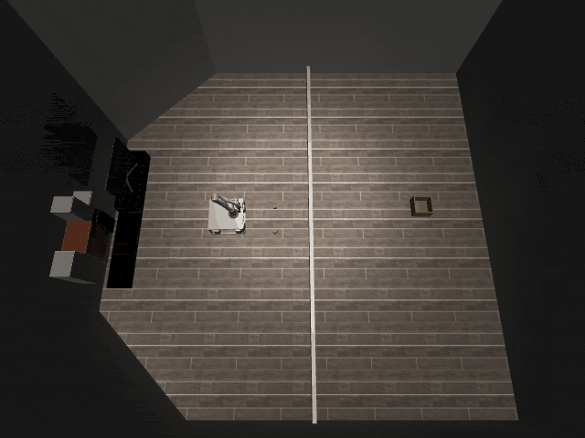

# Tossing3D-o2

## Usage
```python
import kinder
kinder.register_all_environments()
env = kinder.make("kinder/Tossing3D-o2-v0")
```

## Description
Get two cubes into the bin.

## Initial State Distribution


## Random Action Behavior


**Random Action Stats**: Total Reward: -25.00, Success: No, Steps: 25

## Example Demonstration
*(No demonstration GIFs available)*

## Observation Space
The entries of an array in this Box space correspond to the following object features:
| **Index** | **Object** | **Feature** |
| --- | --- | --- |
| 0 | bin_0 | x |
| 1 | bin_0 | y |
| 2 | bin_0 | z |
| 3 | bin_0 | qw |
| 4 | bin_0 | qx |
| 5 | bin_0 | qy |
| 6 | bin_0 | qz |
| 7 | bin_0 | vx |
| 8 | bin_0 | vy |
| 9 | bin_0 | vz |
| 10 | bin_0 | wx |
| 11 | bin_0 | wy |
| 12 | bin_0 | wz |
| 13 | bin_0 | bb_x |
| 14 | bin_0 | bb_y |
| 15 | bin_0 | bb_z |
| 16 | collider:bin_0:12 | x |
| 17 | collider:bin_0:12 | y |
| 18 | collider:bin_0:12 | z |
| 19 | collider:bin_0:12 | qw |
| 20 | collider:bin_0:12 | qx |
| 21 | collider:bin_0:12 | qy |
| 22 | collider:bin_0:12 | qz |
| 23 | collider:bin_0:12 | bb_x |
| 24 | collider:bin_0:12 | bb_y |
| 25 | collider:bin_0:12 | bb_z |
| 26 | collider:bin_0:13 | x |
| 27 | collider:bin_0:13 | y |
| 28 | collider:bin_0:13 | z |
| 29 | collider:bin_0:13 | qw |
| 30 | collider:bin_0:13 | qx |
| 31 | collider:bin_0:13 | qy |
| 32 | collider:bin_0:13 | qz |
| 33 | collider:bin_0:13 | bb_x |
| 34 | collider:bin_0:13 | bb_y |
| 35 | collider:bin_0:13 | bb_z |
| 36 | collider:bin_0:14 | x |
| 37 | collider:bin_0:14 | y |
| 38 | collider:bin_0:14 | z |
| 39 | collider:bin_0:14 | qw |
| 40 | collider:bin_0:14 | qx |
| 41 | collider:bin_0:14 | qy |
| 42 | collider:bin_0:14 | qz |
| 43 | collider:bin_0:14 | bb_x |
| 44 | collider:bin_0:14 | bb_y |
| 45 | collider:bin_0:14 | bb_z |
| 46 | collider:bin_0:15 | x |
| 47 | collider:bin_0:15 | y |
| 48 | collider:bin_0:15 | z |
| 49 | collider:bin_0:15 | qw |
| 50 | collider:bin_0:15 | qx |
| 51 | collider:bin_0:15 | qy |
| 52 | collider:bin_0:15 | qz |
| 53 | collider:bin_0:15 | bb_x |
| 54 | collider:bin_0:15 | bb_y |
| 55 | collider:bin_0:15 | bb_z |
| 56 | collider:bin_0:16 | x |
| 57 | collider:bin_0:16 | y |
| 58 | collider:bin_0:16 | z |
| 59 | collider:bin_0:16 | qw |
| 60 | collider:bin_0:16 | qx |
| 61 | collider:bin_0:16 | qy |
| 62 | collider:bin_0:16 | qz |
| 63 | collider:bin_0:16 | bb_x |
| 64 | collider:bin_0:16 | bb_y |
| 65 | collider:bin_0:16 | bb_z |
| 66 | collider:cuboid_barrier:9 | x |
| 67 | collider:cuboid_barrier:9 | y |
| 68 | collider:cuboid_barrier:9 | z |
| 69 | collider:cuboid_barrier:9 | qw |
| 70 | collider:cuboid_barrier:9 | qx |
| 71 | collider:cuboid_barrier:9 | qy |
| 72 | collider:cuboid_barrier:9 | qz |
| 73 | collider:cuboid_barrier:9 | bb_x |
| 74 | collider:cuboid_barrier:9 | bb_y |
| 75 | collider:cuboid_barrier:9 | bb_z |
| 76 | collider:tossing_room:3 | x |
| 77 | collider:tossing_room:3 | y |
| 78 | collider:tossing_room:3 | z |
| 79 | collider:tossing_room:3 | qw |
| 80 | collider:tossing_room:3 | qx |
| 81 | collider:tossing_room:3 | qy |
| 82 | collider:tossing_room:3 | qz |
| 83 | collider:tossing_room:3 | bb_x |
| 84 | collider:tossing_room:3 | bb_y |
| 85 | collider:tossing_room:3 | bb_z |
| 86 | collider:tossing_room:4 | x |
| 87 | collider:tossing_room:4 | y |
| 88 | collider:tossing_room:4 | z |
| 89 | collider:tossing_room:4 | qw |
| 90 | collider:tossing_room:4 | qx |
| 91 | collider:tossing_room:4 | qy |
| 92 | collider:tossing_room:4 | qz |
| 93 | collider:tossing_room:4 | bb_x |
| 94 | collider:tossing_room:4 | bb_y |
| 95 | collider:tossing_room:4 | bb_z |
| 96 | collider:tossing_room:5 | x |
| 97 | collider:tossing_room:5 | y |
| 98 | collider:tossing_room:5 | z |
| 99 | collider:tossing_room:5 | qw |
| 100 | collider:tossing_room:5 | qx |
| 101 | collider:tossing_room:5 | qy |
| 102 | collider:tossing_room:5 | qz |
| 103 | collider:tossing_room:5 | bb_x |
| 104 | collider:tossing_room:5 | bb_y |
| 105 | collider:tossing_room:5 | bb_z |
| 106 | collider:tossing_room:6 | x |
| 107 | collider:tossing_room:6 | y |
| 108 | collider:tossing_room:6 | z |
| 109 | collider:tossing_room:6 | qw |
| 110 | collider:tossing_room:6 | qx |
| 111 | collider:tossing_room:6 | qy |
| 112 | collider:tossing_room:6 | qz |
| 113 | collider:tossing_room:6 | bb_x |
| 114 | collider:tossing_room:6 | bb_y |
| 115 | collider:tossing_room:6 | bb_z |
| 116 | collider:tossing_room:7 | x |
| 117 | collider:tossing_room:7 | y |
| 118 | collider:tossing_room:7 | z |
| 119 | collider:tossing_room:7 | qw |
| 120 | collider:tossing_room:7 | qx |
| 121 | collider:tossing_room:7 | qy |
| 122 | collider:tossing_room:7 | qz |
| 123 | collider:tossing_room:7 | bb_x |
| 124 | collider:tossing_room:7 | bb_y |
| 125 | collider:tossing_room:7 | bb_z |
| 126 | collider:tossing_room:8 | x |
| 127 | collider:tossing_room:8 | y |
| 128 | collider:tossing_room:8 | z |
| 129 | collider:tossing_room:8 | qw |
| 130 | collider:tossing_room:8 | qx |
| 131 | collider:tossing_room:8 | qy |
| 132 | collider:tossing_room:8 | qz |
| 133 | collider:tossing_room:8 | bb_x |
| 134 | collider:tossing_room:8 | bb_y |
| 135 | collider:tossing_room:8 | bb_z |
| 136 | cube_0 | x |
| 137 | cube_0 | y |
| 138 | cube_0 | z |
| 139 | cube_0 | qw |
| 140 | cube_0 | qx |
| 141 | cube_0 | qy |
| 142 | cube_0 | qz |
| 143 | cube_0 | vx |
| 144 | cube_0 | vy |
| 145 | cube_0 | vz |
| 146 | cube_0 | wx |
| 147 | cube_0 | wy |
| 148 | cube_0 | wz |
| 149 | cube_0 | bb_x |
| 150 | cube_0 | bb_y |
| 151 | cube_0 | bb_z |
| 152 | cube_1 | x |
| 153 | cube_1 | y |
| 154 | cube_1 | z |
| 155 | cube_1 | qw |
| 156 | cube_1 | qx |
| 157 | cube_1 | qy |
| 158 | cube_1 | qz |
| 159 | cube_1 | vx |
| 160 | cube_1 | vy |
| 161 | cube_1 | vz |
| 162 | cube_1 | wx |
| 163 | cube_1 | wy |
| 164 | cube_1 | wz |
| 165 | cube_1 | bb_x |
| 166 | cube_1 | bb_y |
| 167 | cube_1 | bb_z |
| 168 | cuboid_barrier | x |
| 169 | cuboid_barrier | y |
| 170 | cuboid_barrier | z |
| 171 | cuboid_barrier | qw |
| 172 | cuboid_barrier | qx |
| 173 | cuboid_barrier | qy |
| 174 | cuboid_barrier | qz |
| 175 | robot | pos_base_x |
| 176 | robot | pos_base_y |
| 177 | robot | pos_base_rot |
| 178 | robot | pos_arm_joint1 |
| 179 | robot | pos_arm_joint2 |
| 180 | robot | pos_arm_joint3 |
| 181 | robot | pos_arm_joint4 |
| 182 | robot | pos_arm_joint5 |
| 183 | robot | pos_arm_joint6 |
| 184 | robot | pos_arm_joint7 |
| 185 | robot | pos_gripper |
| 186 | robot | vel_base_x |
| 187 | robot | vel_base_y |
| 188 | robot | vel_base_rot |
| 189 | robot | vel_arm_joint1 |
| 190 | robot | vel_arm_joint2 |
| 191 | robot | vel_arm_joint3 |
| 192 | robot | vel_arm_joint4 |
| 193 | robot | vel_arm_joint5 |
| 194 | robot | vel_arm_joint6 |
| 195 | robot | vel_arm_joint7 |
| 196 | robot | vel_gripper |
