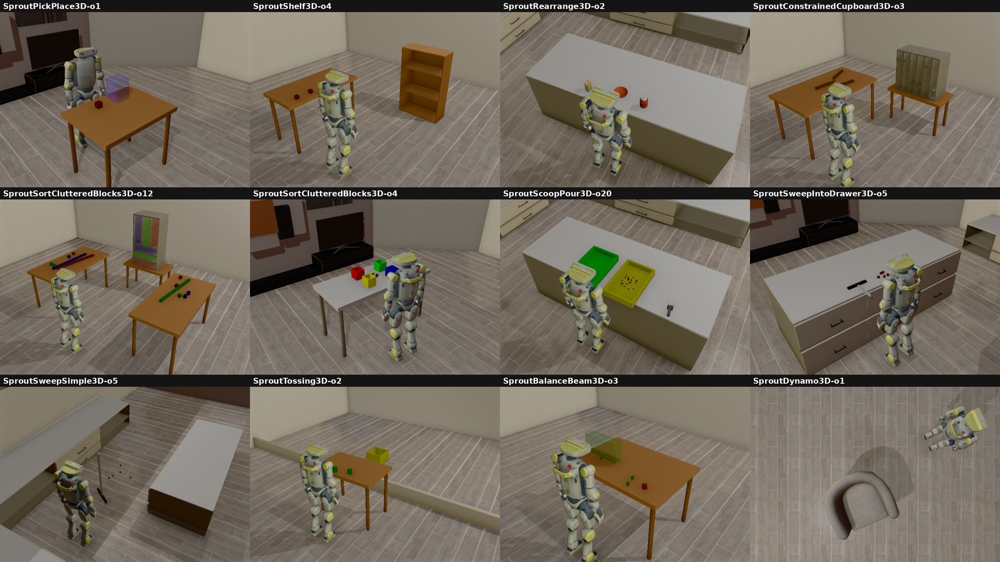
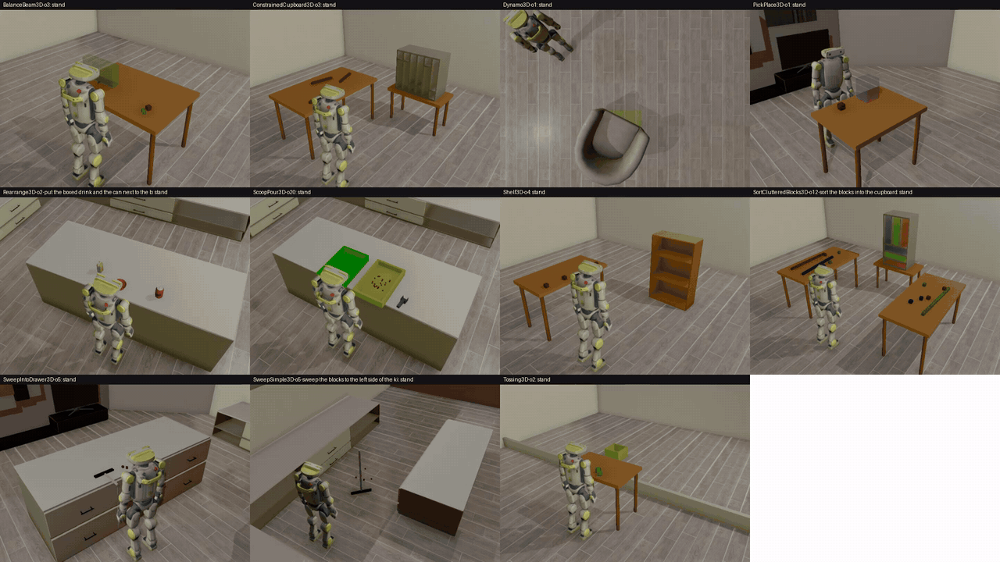
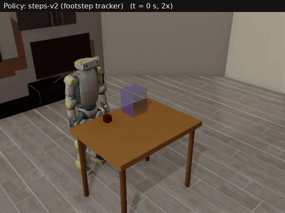
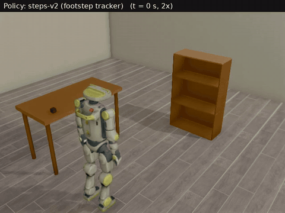
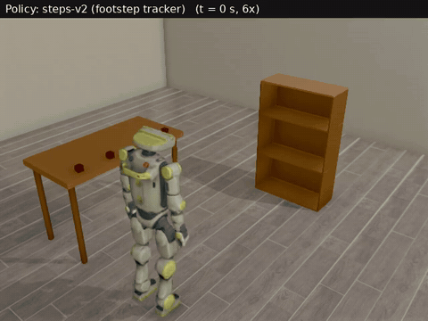
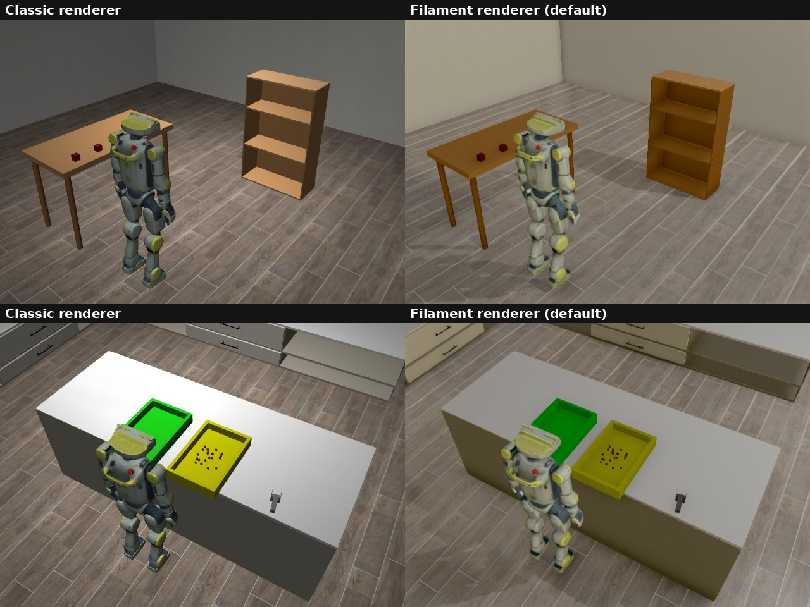

# Sprout humanoid environments

The `Sprout*3D` environments are the dynamic3d MuJoCo tasks of Kinder with the
Fauna Sprout humanoid in place of the TidyBot. There are
44 tasks in 11 families. `Sprout3DBatchEnv` runs many copies of a task in parallel on
the GPU with [MuJoCo Warp](https://github.com/google-deepmind/mujoco_warp).



Kinder has the scenarios only. It has no policies: the action is one position target
for each joint, and the robot has no balance controller. The examples of the robot in
motion on this page use policies from other repositories.

Contents:

- [Installation](#installation)
- [Basic usage](#basic-usage)
- [The robot interface](#the-robot-interface)
- [Task families](#task-families)
- [The robot in the tasks](#the-robot-in-the-tasks)
- [Rendering](#rendering)
- [Utility scripts](#utility-scripts)
- [Limits compared with the other Kinder environments](#limits-compared-with-the-other-kinder-environments)
- [To do](#to-do)

## Installation

The Sprout environments need a newer MuJoCo than the base install of Kinder. We
recommend **MuJoCo 4** (tested on 4.0.1). The base install pins MuJoCo 3.3, so the
Sprout environments have their own requirements file.

1. Use Python 3.11 or 3.12. MuJoCo 4 does not support Python 3.10.
2. Install Kinder without its dependencies, then the Warp requirements:

   ```bash
   git clone https://github.com/Princeton-Robot-Planning-and-Learning/kindergarden.git
   cd kindergarden
   pip install --no-deps -e .
   pip install -r requirements/dynamic3d_warp.txt
   ```

3. Get the Sprout model. The model is not public, so it is not in this repository.
   Copy the vendor model (v0.1.4) into
   `src/kinder/envs/dynamic3d/models/fauna_sprout/`:

   ```
   fauna_sprout/
       sprout.xml
       meshes/        (collision/ and visual/)
       textures/
   ```

   Git ignores these files. Without `sprout.xml`, the Sprout environments are not
   registered, and the rest of Kinder works as before.
4. For the textured lab scenes (`scene_bg=True`), Kinder downloads the scene assets
   (about 2 GB) at the first use.
5. Run the tests:

   ```bash
   pytest tests/envs/dynamic3d/test_sprout3d.py tests/envs/dynamic3d/test_sprout3d_batch.py
   ```

Notes:

- A CUDA GPU is necessary for a useful speed of `Sprout3DBatchEnv`. The single
  environment `Sprout3DEnv` runs on the CPU.
- MuJoCo 3.11 also works, with the classic renderer only. MuJoCo 4.0.0 is excluded,
  because its Newton solver has a fault that 4.0.1 corrects.
- In this install, the TidyBot environments also run, but their trajectories differ
  from those on MuJoCo 3.3. Recorded demos do not replay exactly.
- The script `scripts/run_sprout_walk_policy.py` also needs `onnxruntime` and
  `imageio[ffmpeg]`.

## Basic usage

### One environment (CPU)

`Sprout3DEnv` has the Gymnasium interface of the other Kinder environments.

```python
import numpy as np
import kinder
from kinder.envs.dynamic3d.robots.sprout_robot_env import load_sprout_model

kinder.register_all_environments()
env = kinder.make("kinder/SproutShelf3D-o4-v0", render_mode="rgb_array", scene_bg=True)
obs, info = env.reset(seed=0)

# The action is one position target (rad) for each of the 27 joints, at 50 Hz.
# This action holds the default standing pose. It does not keep the balance.
action = load_sprout_model().default_joint_positions.astype(np.float32)
for _ in range(10):
    obs, reward, terminated, truncated, info = env.step(action)
image = env.render()  # (480, 640, 3)
env.close()
```

### Many parallel worlds (GPU)

`Sprout3DBatchEnv` is not a Gymnasium environment. It is a small class for batch
evaluation: `reset` and `step` work on all worlds at the same time, and their arrays
stay on the GPU. The TidyBot tasks have the same type of batch environment: see
[batch_envs.md](batch_envs.md) for the page of all batch environments.
`kinder.make_batch("kinder/SproutShelf3D-o4-v0", num_worlds=1024)` makes the same
environment as the example below.

```python
from pathlib import Path
import kinder
from kinder.envs.dynamic3d.sprout_batch_env import Sprout3DBatchEnv

tasks = Path(kinder.__file__).parent / "envs" / "dynamic3d" / "tasks"
task = tasks / "SproutShelf3D" / "SproutShelf3D-o4.json"

env = Sprout3DBatchEnv(str(task), num_worlds=1024, seed=0)
obs = env.reset()  # Warp array, one row for each world
for _ in range(100):
    action = env.default_action()  # replace this with the output of a policy
    obs, reward, terminated, truncated, info = env.step(action)

# Worlds do not reset by themselves.
done = terminated.numpy() | truncated.numpy() | info["fallen"].numpy()
env.reset(mask=done)

state = env.get_object_centric_state(world=0)  # for a planner
image = env.render(world=0)
env.close()
```

Facts about the batch environment:

- All worlds use one compiled model. The fixtures have the same poses in all worlds.
  Each world has its own start poses of the objects and the robot.
- `obs`, `reward`, `terminated`, and `truncated` are Warp arrays. Use
  `array.numpy()` for a NumPy copy, or `warp.to_torch(array)` for a torch tensor
  with no copy.
- `terminated` is true when the goal of the task is reached. `info["fallen"]` is true
  when the robot base is below 0.3 m. The reward is -1 at each step.
- Measured speed on one RTX 5090 with MuJoCo 4.0.1, in control steps for each second:
  255,000 (`SproutPickPlace3D-o1`, 4096 worlds), 129,000 (`SproutShelf3D-o8`, 2048
  worlds), 53,000 (`SproutScoopPour3D-o10`, 1024 worlds).

## The robot interface

| Item | Value |
| --- | --- |
| Robot | Floating base, 27 joints, 24.9 kg, about 1.1 m tall |
| Action | 27 joint position targets (rad), absolute |
| Control frequency | 50 Hz (10 physics steps of 0.002 s) |
| Motor model | DC motor: a PD law, then the torque-speed limit of each motor |
| Command delay | Random, 5 to 20 physics steps, new value each 500 steps |
| Observation | Object-centric vector: base pose and velocity, joint positions and velocities, and the pose and velocity of each object |
| Hand reach | 0.48 m to 1.39 m above the floor when the robot stands |

The motor model, the gains, the command delay, and the physics settings are those of
the RL tasks that train the Sprout policies in
[mjlab](https://github.com/mujocolab/mjlab), so that a trained policy has the same
robot here. They are in `src/kinder/envs/dynamic3d/robots/sprout_config.json`.

Options of `Sprout3DEnv` and `Sprout3DBatchEnv`:

- `command_delay_steps=(0, 0)`: no command delay.
- `renderer="classic"`: the renderer of the other Kinder environments.
- `scene_bg=True`: the textured lab scene.

## Task families

Each family is a copy of the TidyBot family with a layout that the Sprout can reach:
objects start on tables and not on the floor, and the work surfaces are higher.

| Family | Variants | Task | Layout change for the Sprout |
| --- | --- | --- | --- |
| `SproutPickPlace3D` | 1 | Put a cube in a goal region | The cube and the goal are on a low table |
| `SproutShelf3D` | 6 | Put 1 to 8 cubes on a cupboard shelf | The cubes start on a table; higher shelves |
| `SproutRearrange3D` | 10 | Put a drink or a can next to a bowl | Higher kitchen island; objects near its edge |
| `SproutConstrainedCupboard3D` | 6 | Put rods into narrow cupboard cells | The rods start on a table; the cupboard is on a stand |
| `SproutSortClutteredBlocks3D` | 4 | Sort blocks by color into bins or shelves | Higher table, or two tables and a cupboard on a stand |
| `SproutScoopPour3D` | 6 | Move small cubes from one bin to the other with a scoop | Higher island; a scoop handle that the hand can hold |
| `SproutSweepIntoDrawer3D` | 1 | Open a drawer and sweep cubes into it | Higher island; drawer handles in the standing reach |
| `SproutSweepSimple3D` | 6 | Sweep cubes on the floor into a region | A wiper with a long handle, as a broom |
| `SproutTossing3D` | 2 | Get a cube into a bin behind a barrier | The cube starts on a table; the bin is nearer |
| `SproutBalanceBeam3D` | 1 | Put blocks on a beam so that it stays level | The beam and the blocks are on a table |
| `SproutDynamo3D` | 1 | Walk to a goal region past a chair | A chair of 5 kg, which the robot can push |

The environment names are `kinder/<Family>-o<N>-v0`, for example
`kinder/SproutShelf3D-o4-v0`. Some families have a task text in the name. To list
them all:

```python
import kinder

kinder.register_all_environments()
print([name for name in kinder.get_all_env_ids() if name.startswith("kinder/Sprout")])
```

## The robot in the tasks

### A walk policy in all families

The vendor walk policy (an ONNX file from the Fauna SDK) runs on top of
`Sprout3DBatchEnv` as an external layer. It stands, walks 0.5 m back, and walks
forward again. In a check of all 44 tasks with 8 worlds each, the robot fell in 1 of
352 worlds.



Video: [walk_grid.mp4](sprout_assets/walk_grid.mp4). Made with:

```bash
python scripts/run_sprout_walk_policy.py --policy-dir <folder of the ONNX policy> \
    --num-worlds 2 --video walk_grid.mp4
```

### Task attempts with trained policies

Two families have an attempt at this time. The attempts use policies that are not in
Kinder: a footstep policy and a hand pose policy, trained with RL in mjlab, with a
hand-made sequence of skills (walk, pick, carry, place) on top. The run is in mjlab,
on a scene that `scripts/export_sprout_scene.py` wrote. The videos show the recorded
states in the Kinder renderer (`scripts/replay_sprout_states.py`).

| Task | Goal reached | Video |
| --- | --- | --- |
| `SproutPickPlace3D-o1` | 13 of 16 worlds | [pick_place.mp4](sprout_assets/pick_place.mp4) |
| `SproutShelf3D-o1` (one cube) | 15 of 16 worlds | [shelf_o1.mp4](sprout_assets/shelf_o1.mp4) |
| `SproutShelf3D-o4` (four cubes) | 2 of 16 worlds | [shelf_o4.mp4](sprout_assets/shelf_o4.mp4) |

`SproutPickPlace3D-o1`, at 2 times the real speed:



`SproutShelf3D-o1`, at 2 times the real speed:



`SproutShelf3D-o4`, at 6 times the real speed. This is one of the two worlds with
success. In the other worlds, a pick or a place of one of the later cubes failed:



The other 9 families have no attempt. Their scenes load and their physics is checked,
but nothing shows that the Sprout can complete them. Four of them need a skill that
does not exist: rod insertion, tool use (scoop, wiper), or drawer opening.

## Rendering

With MuJoCo 4, `render()` uses the Filament renderer: physically-based materials,
soft shadows, ambient occlusion, and the normal map of the robot. The classic
renderer overexposes light surfaces; Filament shows the declared colors.



- The renderer compiles a copy of the scene for the render only, with physical lights
  and materials (`sprout_render.py`). The physics model does not change.
- One frame at 640 x 480 takes 2 to 4 ms. The first frame after a reset takes about
  0.2 s, because a reset makes a new scene.
- Filament images are not equal to the last bit: two renders of one state differ by
  about 0.5 color levels on average.
- `render_all_cameras()` uses the classic renderer.

## Utility scripts

| Script | Use |
| --- | --- |
| `scripts/make_sprout_tasks.py` | Makes the 44 Sprout task files from the TidyBot task files. To change a layout, change the function of its family there and run the script. `--check` compares the files with its output. |
| `scripts/export_sprout_scene.py` | Writes a task as plain MuJoCo XML, with many start states and the goal regions as data. Use it to train or test policies for a task in another simulator, for example mjlab. |
| `scripts/replay_sprout_states.py` | Shows a run from another simulator in the Kinder scene: reads the recorded poses and writes a video and a GIF. |
| `scripts/run_sprout_walk_policy.py` | Runs the vendor walk policy in the tasks, as a check of the robot and the scenes, and as an example of a policy layer over `Sprout3DBatchEnv`. |

Export a task for mjlab:

```bash
python scripts/export_sprout_scene.py kinder/SproutShelf3D-o1-v0 <folder> --num-starts 64
```

The folder gets `fixtures.xml` (all fixtures, with the drawer joints), one XML file
for each object (with its meshes), and `task.json` (start states of the robot and the
objects, goal regions, and buffer sizes for MuJoCo Warp).

## Limits compared with the other Kinder environments

- **The robot model is not distributed.** Each user needs the model files.
- **No policies and no controllers.** A zero action or a random action makes the
  robot fall. The other environments have robots that are stable with any action.
- **No demos.** No demonstration data exists for the Sprout tasks, and the demo
  collection tools are not adapted to the Sprout.
- **No generated environment pages.** The other families have a page in `docs/envs/`
  with random action GIFs. The Sprout families have this page only.
- **Not in the cloud CI.** See [To do](#to-do).
- **A different MuJoCo.** The Sprout environments need the Warp requirements file
  (MuJoCo 4). The base install (MuJoCo 3.3) cannot run `Sprout3DBatchEnv`.
- **The batch environment is not a Gymnasium environment**, and its reward is -1 at
  each step for all tasks. Its goal check has the predicates `on`, `in`, and
  `balanced`.
- **Only 2 of 11 families have an attempt.** See
  [Task attempts](#task-attempts-with-trained-policies).
- **`SproutDynamo3D` has one variant.** The TidyBot family has three.
- **Start states.** In tasks with piles of blocks or rods, an object can fall from the
  pile or slide slowly after the settle time of the reset (1 s). A settle time of 4 s
  makes this less frequent, but it does not remove it.
- **MuJoCo Warp is not identical to CPU MuJoCo.** A world of the batch environment and
  `Sprout3DEnv` drift apart when the robot moves. Objects at rest agree.
- **Filament is tested on one machine** (Linux, NVIDIA GPU, no display). Use
  `renderer="classic"` if it does not work.

## To do

- [ ] **CI.** The cloud CI skips all Sprout tests that need the model: it has no
  model, no GPU, and MuJoCo 3.3. Only the test of the task files against
  `scripts/make_sprout_tasks.py` runs there. Options: a lab machine as a CI runner,
  or a public stand-in robot for the tests.
- [ ] **Model distribution.** A private location for the model files, and a download
  script.
- [ ] **Start state quality.** A check at the reset that rejects a start state where
  an object still moves, for the tasks with piles of blocks or rods. A longer settle
  time is not sufficient.
- [ ] **Attempts for the other 9 families**, in this order of effort:
  `SproutDynamo3D` (walk only), `SproutTossing3D`, `SproutRearrange3D`,
  `SproutBalanceBeam3D`, `SproutSortClutteredBlocks3D`, then the families that need
  new skills.
- [ ] **Generated environment pages** in `docs/envs/` for the Sprout families.
- [ ] **Demos** for the tasks with a successful attempt.
- [ ] **Shadows in the kitchen scenes.** The key light of the Filament render is weak
  there.
